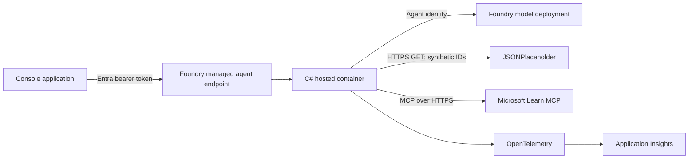

# Architecture

## Components and trust boundaries



1. **External-client boundary:** the client obtains a token for `https://ai.azure.com/.default`.
   Foundry authorizes invocation; the container never accepts a caller-supplied Azure credential.
2. **Agent/model boundary:** Foundry creates a dedicated agent identity. The container uses
   `DefaultAzureCredential` in hosted execution and the project endpoint injected by the platform.
3. **Third-party REST boundary:** only bounded synthetic user IDs are sent to JSONPlaceholder.
4. **Microsoft MCP boundary:** the adapter connects only to `https://learn.microsoft.com/api/mcp`,
   discovers tools, requires `microsoft_docs_search`, and invokes only that tool.
5. **Observability boundary:** AgentServer and Agent Framework emit traces. Do not enable sensitive
   prompt/tool payload capture without a reviewed retention and access policy.

## REST request sequence

```text
User prompt
  -> model selects one or more function tools
  -> tool validates userId (1..10)
  -> HttpClient GET with 10-second timeout
  -> structured { success, tool, data|error } result
  -> model synthesizes response and names tools used
```

The framework can issue independent tool calls in the same model turn. TC-05 verified that
`get_user_details` and `get_user_tasks` are both selected for a combined request.

## MCP request sequence

```text
User asks Microsoft documentation question
  -> model selects microsoft_docs_search
  -> wrapper validates query (1..500 chars)
  -> MCP initialize
  -> tools/list
  -> require exact microsoft_docs_search tool
  -> tools/call
  -> retain top 5 title/link/excerpt results
  -> model summarizes with Learn URL
```

Discovery occurs for every MCP invocation in this POC. A production implementation can reuse a
connection per hosted session, but must handle reconnects, endpoint identity, concurrent requests,
and stale discovery safely.

## Hosted conversation state

The Responses protocol supports `previous_response_id`. AgentServer uses local file/in-process
storage during local runs and Foundry-managed durable session storage in hosted execution. This POC
does not add a separate memory database.

## Why this is an agent

Unlike the fixed Secure Policy RAG workflow, this request can require an open-ended combination of
REST and MCP tools. The model selects the required read-only tools; deterministic code still owns
input validation, HTTP operations, timeouts, and error contracts.
